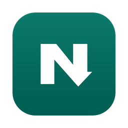
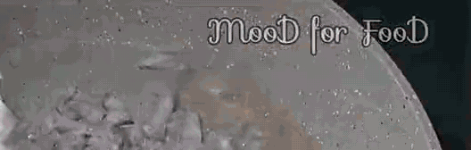
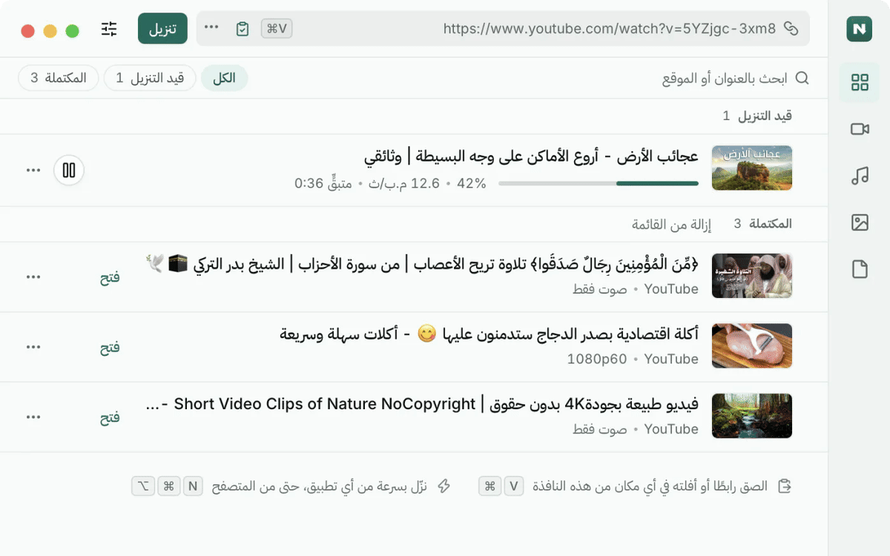
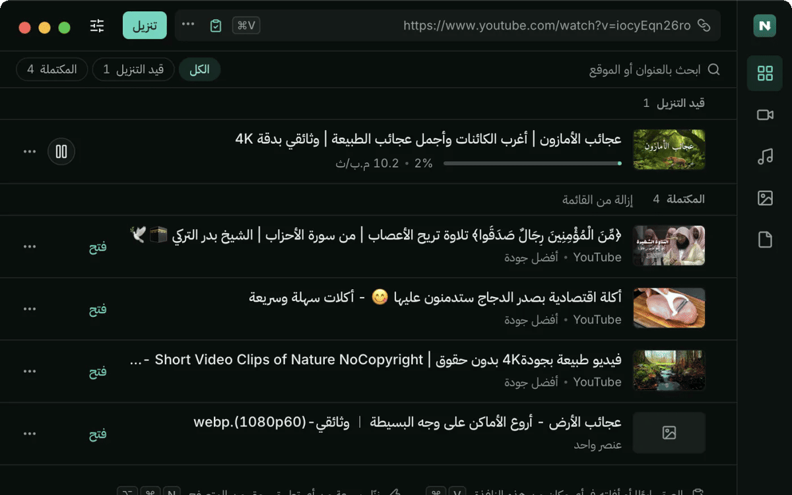
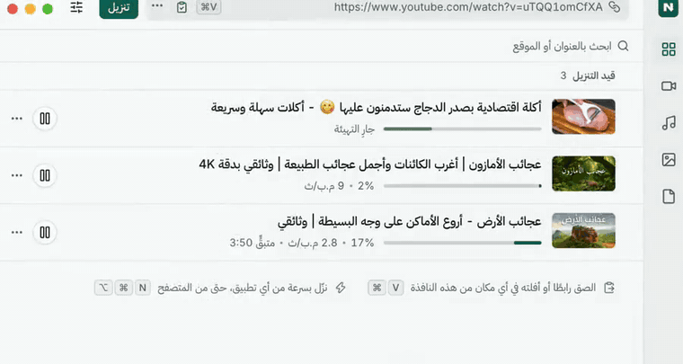
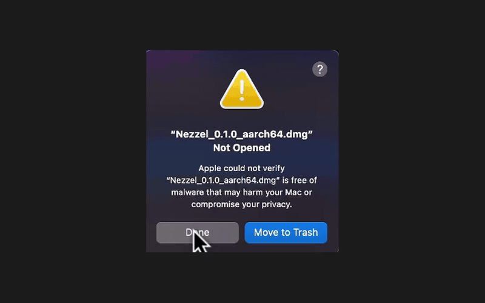
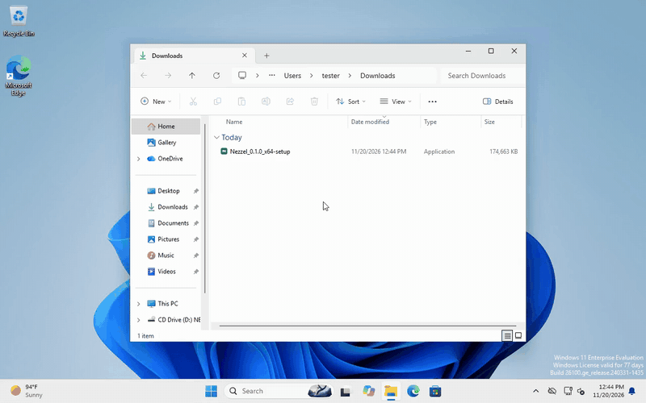

<div align="center">



# Nezzel Desktop

**Paste a link. Pick a quality. Save it.**

Save videos, audio and photos from public links on macOS, Windows and Linux.<br>
Free and open source. No ads. In English, Arabic and French.

<a href="https://github.com/ahmed-abdat/nezzel-desktop/releases/latest"></a>

[](https://github.com/ahmed-abdat/nezzel-desktop/releases/latest)
[](#install)
[](LICENSE)

[Website](https://nezzel.hululsoft.mr) · [Nezzel for Android](https://github.com/ahmed-abdat/nezzel) · [العربية](#بالعربية) · [Français](#en-français) · [Developers](#for-developers)



<br>

<a href=".github/assets/app-ar-light-list.png"></a>&nbsp;
<a href=".github/assets/app-ar-dark-list.png"></a>

</div>

## How it works

1. Copy a link from YouTube, TikTok, Instagram, Facebook, X or another site.
2. Nezzel picks up the copied link (or paste it into the link field).
3. Choose a quality, or audio only, and click **Download**. Files go to `Downloads/Nezzel`.

You only see qualities the site really offers. Your library keeps a list of what you saved.

<div align="center">

</div>

## Install

Download the file for your system from the [latest release](https://github.com/ahmed-abdat/nezzel-desktop/releases/latest):

| Your system | File to download |
| --- | --- |
| Mac with Apple Silicon (M1 or newer) | `Nezzel_…_aarch64.dmg` |
| Mac with Intel | `Nezzel_…_x64.dmg` |
| Windows | `Nezzel_…_x64-setup.exe` |
| Ubuntu, Debian | `Nezzel_…_amd64.deb` |
| Fedora | `Nezzel-…x86_64.rpm` |
| Other Linux | `Nezzel_…_amd64.AppImage` |

Not sure which Mac you have? Apple menu → About This Mac: "Chip: Apple M…" is Apple Silicon, "Processor: Intel" is Intel. The `arm64` / `aarch64` files for Windows and Linux are for ARM computers; the `-portable.zip` files run without installing.

The app isn't code-signed yet, so macOS and Windows ask once before it opens. This is expected:

**macOS**

1. Open the downloaded `.dmg`. macOS says it can't verify it: click **Done** (not Move to Trash).
2. Open System Settings → Privacy & Security, scroll down and click **Open Anyway**, then confirm with your password or Touch ID. The disk image opens.
3. Drag Nezzel to Applications and open it. macOS asks once more for the app itself: click **Done** and repeat step 2.

<details>
<summary>Watch it on macOS 15 (29 s)</summary>



</details>

On macOS 14 or earlier you can right-click the app and choose Open instead. From Terminal: `xattr -dr com.apple.quarantine /Applications/Nezzel.app`.

**Windows**

1. Open the `-setup.exe`. A blue "Windows protected your PC" notice may appear.
2. Click **More info**, then **Run anyway**.

<details>
<summary>Watch it on Windows 11 (39 s)</summary>



</details>

**Linux**

- Ubuntu or Debian: `sudo apt install ./Nezzel_*.deb`
- Fedora: `sudo dnf install ./Nezzel-*.rpm`
- Any other distro: `chmod +x Nezzel*.AppImage`, then run it.

The `.deb` and `.rpm` need glibc 2.35 or newer (Ubuntu 22.04, Debian 12, Fedora 36 or later), because the Linux builds are made on Ubuntu 22.04.

**When a site needs your login.** Nezzel uses your browser's login automatically (see Sites above) and never sends cookies or passwords anywhere. On a Mac, macOS may ask permission first; if you decline, that one download fails and you can retry:

- **Keychain** (Chrome, Edge, Brave and similar): a prompt to unlock your browser's Keychain item. Click **Always Allow** to be asked once, or **Allow** to be asked again next time.
- **Safari**: if the download fails, open System Settings → Privacy & Security → Full Disk Access, turn on Nezzel, then restart Nezzel.
- **Automation** ("control your browser"): asked by the quick download bar to read your open tab's link. Click **Allow**, or **Don't Allow** and Nezzel uses the copied link instead. Change it later in System Settings → Privacy & Security → Automation.

The tools Nezzel uses (yt-dlp, ffmpeg and the rest) come inside the installer, so nothing is downloaded on first start. After that Nezzel keeps them and itself up to date; you can turn both off in Settings.

On Linux Wayland, bind **Quick download** in your desktop's custom keyboard shortcuts to
`/usr/bin/nezzel --capture` (`.deb` / `.rpm`). This opens the quick bar in the running instance,
or starts Nezzel if needed. For AppImage, bind the full path to the executable AppImage instead,
for example `"/home/you/Applications/Nezzel.AppImage" --capture`; keep it at that path.
Settings and the welcome screen offer the command for your installation with a copy button.
On desktops without Wayland data-control (including GNOME), copied links are picked up when
Nezzel's window is in front.

## Sites

Tested with real public links: **YouTube, TikTok, X, Facebook, Instagram reels, Bluesky, Pinterest, Telegram channels, Reddit images, LinkedIn, Snapchat Spotlight, Vimeo, Dailymotion, Twitch clips** and **SoundCloud** audio. That includes photos and multi-photo posts from X, Bluesky, Pinterest and Telegram. Many more sites work through [yt-dlp](https://github.com/yt-dlp/yt-dlp) and [gallery-dl](https://github.com/mikf/gallery-dl), which Nezzel keeps up to date.

Some posts only open when you're signed in (many Instagram and Reddit posts, for example). Nezzel then uses the browser you're signed in with automatically, only that site's cookies are used, on your computer, and you can switch it off in Settings → Logins. Private posts, paid content and DRM-protected video are not supported.

A link doesn't work? [Open a site support issue](https://github.com/ahmed-abdat/nezzel-desktop/issues/new/choose). No link is required.

## FAQ

**Is it free?** Yes, and open source under the AGPL-3.0. No ads, no paid tier.

**Does Nezzel send anything to a server?** Crash and error reports go to our own Sentry project, and anonymous daily usage counts (features used, sites by domain only, never links or file names) go to our own server. Both are on by default and have a switch in Settings. Details in [PRIVACY.md](PRIVACY.md).

**Why does my OS warn me when I install it?** The app isn't code-signed yet. See [Install](#install) for the one-time step.

**Where are my files?** In `Downloads/Nezzel` unless you pick another folder in Settings. Removing an item from the list never deletes the file.

**Is there a phone version?** Yes: [Nezzel for Android](https://github.com/ahmed-abdat/nezzel).

<div dir="rtl">

## بالعربية

‏**Nezzel Desktop** تطبيق مجاني ومفتوح المصدر لأجهزة macOS وWindows وLinux، يحفظ الفيديو والصوت والصور من الروابط العامة، بلا إعلانات.

انسخ الرابط، فيلتقطه Nezzel تلقائيًا (أو الصقه في خانة الرابط)، ثم اختر الجودة واضغط «تنزيل». تُحفظ الملفات في مجلد ‎`Downloads/Nezzel`‎.

حمّل التطبيق من [صفحة الإصدارات](https://github.com/ahmed-abdat/nezzel-desktop/releases/latest). اختر الملف المناسب لجهازك: ‎`aarch64.dmg`‎ لماك بمعالج Apple (M1 وما بعده)، ‎`x64.dmg`‎ لماك Intel، ‎`x64-setup.exe`‎ لويندوز، و‎`.deb`‎ أو ‎`.rpm`‎ أو ‎`AppImage`‎ للينكس.

التطبيق غير موقّع بعد، لذلك يسألك النظام مرة واحدة قبل فتحه، وهذا متوقَّع. في macOS: افتح الملف الذي نزّلته، اضغط «تم» في التنبيه، ثم افتح «إعدادات النظام ← الخصوصية والأمن» واضغط «فتح على أي حال». في Windows: اضغط «مزيد من المعلومات» (More info) ثم «تشغيل على أي حال» (Run anyway).

عندما يطلب موقع تسجيل الدخول: بعض الروابط لا تُفتح إلا وأنت مسجّل الدخول. يقرأ Nezzel حينها تسجيل دخولك إلى ذلك الموقع من متصفحك على حاسوبك، ولا يُرسَل أي كوكيز أو كلمة سر إلى أي جهة. يلزم ذلك فقط للمحتوى الذي يتطلب حسابًا، ويمكنك إيقافه من «الإعدادات ← تسجيلات الدخول». في macOS قد يطلب النظام إذنك أولًا، وإن رفضت يفشل ذلك التنزيل وحده فتعيد المحاولة. «سلسلة المفاتيح» (Chrome وEdge وBrave): اضغط «السماح دائمًا» ليسألك مرة واحدة، أو «السماح» ليسألك في كل مرة. Safari: إن فشل التنزيل ففعّل Nezzel في «إعدادات النظام ← الخصوصية والأمن ← الوصول الكامل إلى القرص» ثم أعد تشغيله. «الأتمتة» (التحكم في المتصفح): تطلبها شريط التنزيل السريع لقراءة رابط تبويبك المفتوح؛ اضغط «السماح»، أو «رفض» فيستخدم Nezzel الرابط المنسوخ.

لا يوجد حساب في Nezzel. تُرسَل تقارير الأعطال والأخطاء إلى مشروعنا في Sentry (في الاتحاد الأوروبي)، وأعداد استخدام يومية مجهولة إلى خادمنا، دون الروابط أو أسماء الملفات أو المسارات أو الكوكيز. كلاهما مفعّل افتراضيًا ويمكنك إيقافه من الإعدادات. وعندما يطلب موقع تسجيل الدخول يستخدم متصفحك تلقائيًا، ولا يستخدم إلا كوكيز ذلك الموقع على حاسوبك، ويمكنك إيقاف ذلك من «الإعدادات ← تسجيلات الدخول». التفاصيل في [PRIVACY.md](PRIVACY.md).

يوجد أيضًا [Nezzel لأندرويد](https://github.com/ahmed-abdat/nezzel).

</div>

## En français

**Nezzel Desktop** est une application gratuite et libre pour macOS, Windows et Linux qui enregistre vidéos, sons et photos depuis des liens publics, sans publicité.

Copiez un lien : Nezzel le détecte (ou collez-le dans le champ). Choisissez la qualité, puis cliquez sur «&nbsp;Télécharger&nbsp;». Les fichiers vont dans `Downloads/Nezzel`. Téléchargez l’application depuis la [page des versions](https://github.com/ahmed-abdat/nezzel-desktop/releases/latest).

Choisissez le fichier de votre système : `aarch64.dmg` pour un Mac Apple Silicon (M1 ou plus récent), `x64.dmg` pour un Mac Intel, `x64-setup.exe` pour Windows, `.deb`, `.rpm` ou `AppImage` pour Linux.

L’application n’est pas encore signée : le système demande une confirmation, une seule fois. Sur macOS, ouvrez le fichier téléchargé, cliquez sur «&nbsp;Terminé&nbsp;», puis dans Réglages Système → Confidentialité et sécurité cliquez sur «&nbsp;Ouvrir quand même&nbsp;». Sur Windows, cliquez sur «&nbsp;Informations complémentaires&nbsp;» puis «&nbsp;Exécuter quand même&nbsp;».

Quand un site demande votre connexion : certains liens ne s’ouvrent que si vous êtes connecté. Nezzel lit alors votre connexion à ce site depuis votre navigateur, sur votre ordinateur ; cookies et mots de passe ne sont envoyés nulle part. Cela ne sert que pour les contenus qui exigent un compte, et vous pouvez le désactiver dans Réglages → Connexions. Sur Mac, macOS peut demander l’autorisation d’abord ; si vous refusez, ce seul téléchargement échoue et vous pouvez réessayer. Trousseau (Chrome, Edge, Brave) : cliquez sur «&nbsp;Toujours autoriser&nbsp;» pour n’être sollicité qu’une fois, ou «&nbsp;Autoriser&nbsp;» pour l’être à chaque fois. Safari : si le téléchargement échoue, activez Nezzel dans Réglages Système → Confidentialité et sécurité → Accès complet au disque, puis relancez Nezzel. Automatisation («&nbsp;contrôler le navigateur&nbsp;») : demandée par la barre de téléchargement rapide pour lire le lien de l’onglet ouvert ; cliquez sur «&nbsp;Autoriser&nbsp;», ou «&nbsp;Refuser&nbsp;» et Nezzel utilise le lien copié.

Il n’y a pas de compte Nezzel. Les rapports de plantage et d’erreur partent vers notre projet Sentry (UE) et des compteurs d’usage quotidiens anonymes vers notre serveur, sans liens, noms de fichiers, chemins ni cookies. Les deux sont activés par défaut et se désactivent dans les Réglages. Détails dans [PRIVACY.md](PRIVACY.md).

## For developers

Tauri 2 (Rust) with a Vue 3 + TypeScript front end. Needs Node.js 22+, [pnpm](https://pnpm.io/) 12, Rust (rustup) and Python 3.

```sh
git clone https://github.com/ahmed-abdat/nezzel-desktop.git && cd nezzel-desktop
pnpm install
pnpm tauri dev      # run in development
pnpm tauri build    # build an installer for this OS
```

| Path | What it does |
| --- | --- |
| `src/` | Vue UI, stores and translations |
| `src-tauri/` | Rust back end: link readers, yt-dlp and gallery-dl runners, download queue, tool downloads |
| `tests/` | Vitest unit tests and Playwright end-to-end tests |

Issues and small pull requests are welcome: start with [CONTRIBUTING.md](CONTRIBUTING.md). Security reports go through [SECURITY.md](SECURITY.md). Changes are in [CHANGELOG.md](CHANGELOG.md).

## Based on Open Video Downloader

Nezzel Desktop is a fork of [Open Video Downloader](https://github.com/jely2002/youtube-dl-gui)
(youtube-dl-gui), Copyright © Jelle Glebbeek and contributors, licensed under the
[GNU AGPL-3.0](LICENSE). Nezzel keeps that licence; thank you to the upstream authors.
Downloads are done by [yt-dlp](https://github.com/yt-dlp/yt-dlp), [gallery-dl](https://github.com/mikf/gallery-dl) and [ffmpeg](https://ffmpeg.org/).

## License and responsible use

[AGPL-3.0-or-later](LICENSE). The Nezzel and Hululsoft names and logos are not covered by the licence.

Use Nezzel only for content you have the right to save. You are responsible for following your local laws and each site's terms; the maintainers are not liable for misuse (AGPL-3.0, section 16). Nezzel isn't affiliated with any site and doesn't get around DRM or logins.
