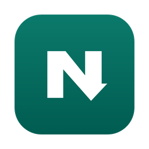
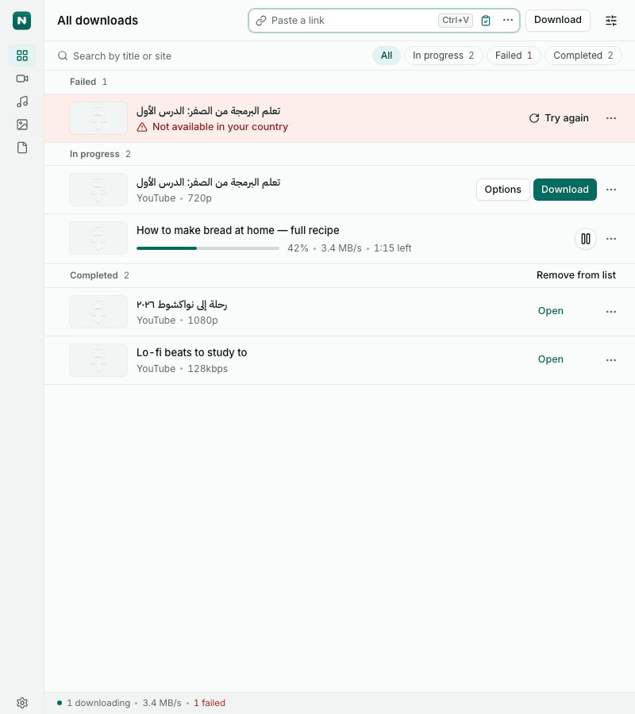
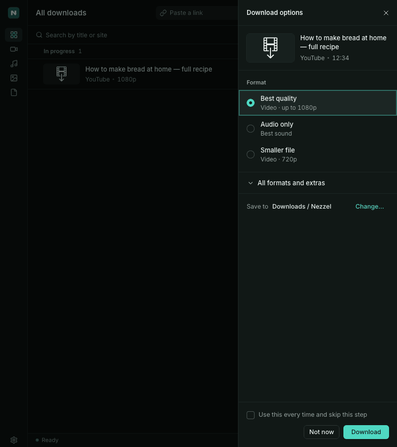
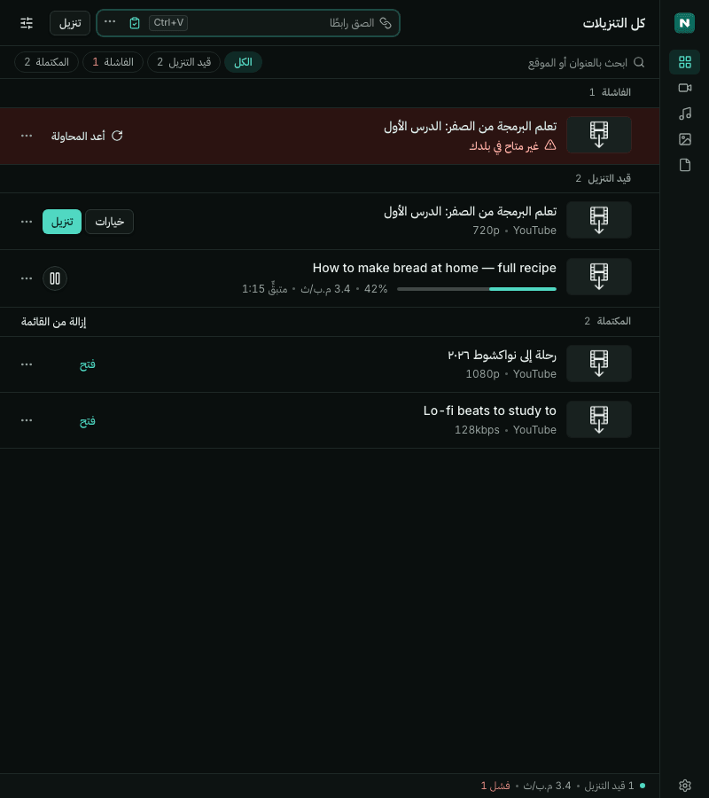
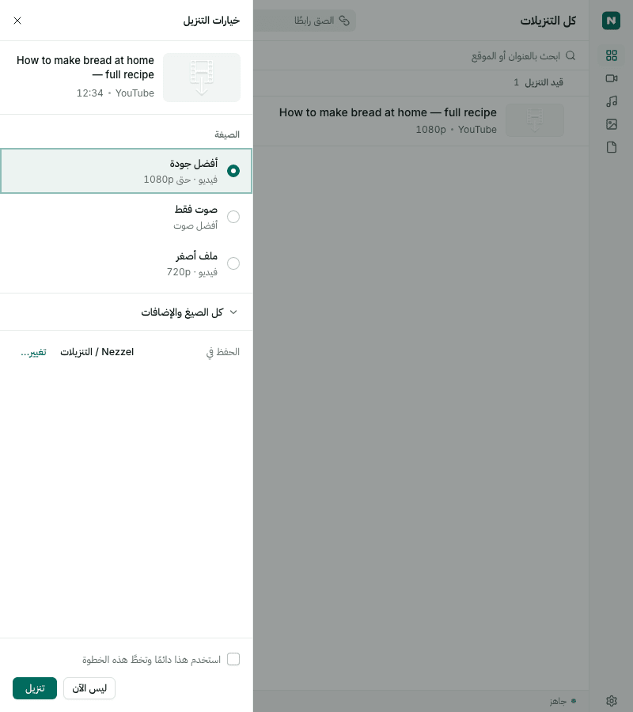

<div align="center">



# Nezzel Desktop

**Paste a link. Pick a quality. Save it.**

Save videos, audio and photos from public links on macOS, Windows and Linux.<br>
Free and open source. No ads, no account. In English, Arabic and French.

<a href="https://github.com/ahmed-abdat/nezzel-desktop/releases/latest"></a>

[](https://github.com/ahmed-abdat/nezzel-desktop/releases/latest)
[](#install)
[](LICENSE)

[Website](https://nezzel.hululsoft.mr) · [Nezzel for Android](https://github.com/ahmed-abdat/nezzel) · [العربية](#بالعربية) · [Français](#en-français) · [Developers](#for-developers)

<a href=".github/assets/list-en-light.png"></a>&nbsp;
<a href=".github/assets/options-en-dark.png"></a><br>
<a href=".github/assets/list-ar-dark.png"></a>&nbsp;
<a href=".github/assets/options-ar-light.png"></a>

</div>

## How it works

1. Copy a link from YouTube, TikTok, Instagram, Facebook, X or another site.
2. Nezzel picks up the copied link (or paste it into the link field).
3. Choose a quality, or audio only, and click **Download**. Files go to `Downloads/Nezzel`.

You only see qualities the site really offers. Your library keeps a list of what you saved.

## Install

Download the installer for your system from the [latest release](https://github.com/ahmed-abdat/nezzel-desktop/releases/latest). Its tools (yt-dlp, ffmpeg and the rest) come inside the installer, so nothing is downloaded on first start. After that Nezzel keeps them and itself up to date; you can turn both off in Settings.

- **macOS:** the beta isn't signed by Apple yet. Open the app once, then go to System Settings → Privacy & Security and click **Open Anyway** (older macOS: right-click the app → Open). Or run `xattr -dr com.apple.quarantine /Applications/Nezzel.app` in Terminal.
- **Windows:** SmartScreen may warn about an unknown publisher. Click **More info → Run anyway**.
- **Linux:** on Ubuntu or Debian, install the `.deb` (`sudo apt install ./Nezzel_*.deb`). On Fedora, install the `.rpm` (`sudo dnf install ./Nezzel-*.rpm`). On any other distro, make the AppImage executable (`chmod +x Nezzel*.AppImage`) and run it. The `.deb` and `.rpm` need glibc 2.35 or newer (Ubuntu 22.04, Debian 12, Fedora 36 or later), because the Linux builds are made on Ubuntu 22.04.

## Sites

Tested with real public links: **YouTube, TikTok, X, Facebook, Instagram reels, Bluesky, Pinterest, Telegram channels, Reddit images, LinkedIn, Snapchat Spotlight, Vimeo, Dailymotion, Twitch clips** and **SoundCloud** audio. That includes photos and multi-photo posts from X, Bluesky, Pinterest and Telegram. Many more sites work through [yt-dlp](https://github.com/yt-dlp/yt-dlp) and [gallery-dl](https://github.com/mikf/gallery-dl), which Nezzel keeps up to date.

Some posts only open when you're signed in (many Instagram and Reddit posts, for example). Nezzel can then use the browser you're signed in with, but only after you say yes, and only that site's cookies are passed on. Private posts, paid content and DRM-protected video are not supported.

A link doesn't work? [Open a site support issue](https://github.com/ahmed-abdat/nezzel-desktop/issues/new/choose). No link is required.

## FAQ

**Is it free?** Yes, and open source under the AGPL-3.0. No ads, no account, no paid tier.

**Does Nezzel send anything to a server?** No account and no ads. Crash and error reports go to our own Sentry project, and anonymous daily usage counts (features used, sites by domain only, never links or file names) go to our own server. Both are on by default and have a switch in Settings. Details in [PRIVACY.md](PRIVACY.md).

**Why does my OS warn me when I install it?** The beta isn't code-signed yet. See [Install](#install) for the one-time step.

**Where are my files?** In `Downloads/Nezzel` unless you pick another folder in Settings. Removing an item from the list never deletes the file.

**Is there a phone version?** Yes: [Nezzel for Android](https://github.com/ahmed-abdat/nezzel).

<div dir="rtl">

## بالعربية

‏**Nezzel Desktop** تطبيق مجاني ومفتوح المصدر لأجهزة macOS وWindows وLinux، يحفظ الفيديو والصوت والصور من الروابط العامة، بلا إعلانات ولا حساب.

انسخ الرابط، فيلتقطه Nezzel تلقائيًا (أو الصقه في خانة الرابط)، ثم اختر الجودة واضغط «تنزيل». تُحفظ الملفات في مجلد ‎`Downloads/Nezzel`‎.

حمّل التطبيق من [صفحة الإصدارات](https://github.com/ahmed-abdat/nezzel-desktop/releases/latest). النسخة التجريبية غير موقّعة بعد، لذلك قد يحذّرك النظام عند فتحها أول مرة: في macOS افتح «إعدادات النظام ← الخصوصية والأمن» واضغط «فتح على أي حال»، وفي Windows اضغط «More info» ثم «Run anyway».

لا يوجد خادم لـ Nezzel. تُرسَل تقارير الأعطال والأخطاء إلى مشروعنا في Sentry (في الاتحاد الأوروبي) وهي مفعّلة افتراضيًا، دون الروابط أو أسماء الملفات أو المسارات أو الكوكيز، ويمكنك إيقافها من الإعدادات أو من شاشة الترحيب. ولا يقرأ ملفات تعريف الارتباط (الكوكيز) من متصفحك إلا بعد موافقتك، ولا يمرّر إلا كوكيز الموقع الذي طلبها. التفاصيل في [PRIVACY.md](PRIVACY.md).

يوجد أيضًا [Nezzel لأندرويد](https://github.com/ahmed-abdat/nezzel).

</div>

## En français

**Nezzel Desktop** est une application gratuite et libre pour macOS, Windows et Linux qui enregistre vidéos, sons et photos depuis des liens publics, sans publicité ni compte.

Copiez un lien : Nezzel le détecte (ou collez-le dans le champ). Choisissez la qualité, puis cliquez sur «&nbsp;Télécharger&nbsp;». Les fichiers vont dans `Downloads/Nezzel`. Téléchargez l’application depuis la [page des versions](https://github.com/ahmed-abdat/nezzel-desktop/releases/latest).

La bêta n’est pas encore signée : au premier lancement, macOS demande d’autoriser l’app dans Réglages Système → Confidentialité et sécurité, et Windows SmartScreen demande «&nbsp;Informations complémentaires → Exécuter quand même&nbsp;». Il n’y a pas de serveur Nezzel. Les rapports de plantage et d’erreur partent vers notre projet Sentry (UE), activés par défaut, sans liens, noms de fichiers, chemins ni cookies ; vous pouvez les désactiver dans les Réglages ou sur l’écran d’accueil. Détails dans [PRIVACY.md](PRIVACY.md).

## For developers

Tauri 2 (Rust) with a Vue 3 + TypeScript front end. Needs Node.js 22+, [pnpm](https://pnpm.io/) 12, Rust (rustup) and Python 3.

```sh
git clone https://github.com/ahmed-abdat/nezzel-desktop.git && cd nezzel-desktop
pnpm install
pnpm tauri dev      # run in development
pnpm tauri build    # build an installer for this OS
```

| Path | What it does |
| --- | --- |
| `src/` | Vue UI, stores and translations |
| `src-tauri/` | Rust back end: link readers, yt-dlp and gallery-dl runners, download queue, tool downloads |
| `tests/` | Vitest unit tests and Playwright end-to-end tests |

Issues and small pull requests are welcome: start with [CONTRIBUTING.md](CONTRIBUTING.md). Security reports go through [SECURITY.md](SECURITY.md). Changes are in [CHANGELOG.md](CHANGELOG.md).

## Based on Open Video Downloader

Nezzel Desktop is a fork of [Open Video Downloader](https://github.com/jely2002/youtube-dl-gui)
(youtube-dl-gui), Copyright © Jelle Glebbeek and contributors, licensed under the
[GNU AGPL-3.0](LICENSE). Nezzel keeps that licence; thank you to the upstream authors.
Downloads are done by [yt-dlp](https://github.com/yt-dlp/yt-dlp), [gallery-dl](https://github.com/mikf/gallery-dl) and [ffmpeg](https://ffmpeg.org/).

## License and responsible use

[AGPL-3.0-or-later](LICENSE). The Nezzel and Hululsoft names and logos are not covered by the licence.

Use Nezzel only for content you have the right to save. You are responsible for following your local laws and each site's terms; the maintainers are not liable for misuse (AGPL-3.0, section 16). Nezzel isn't affiliated with any site and doesn't get around DRM or logins.
